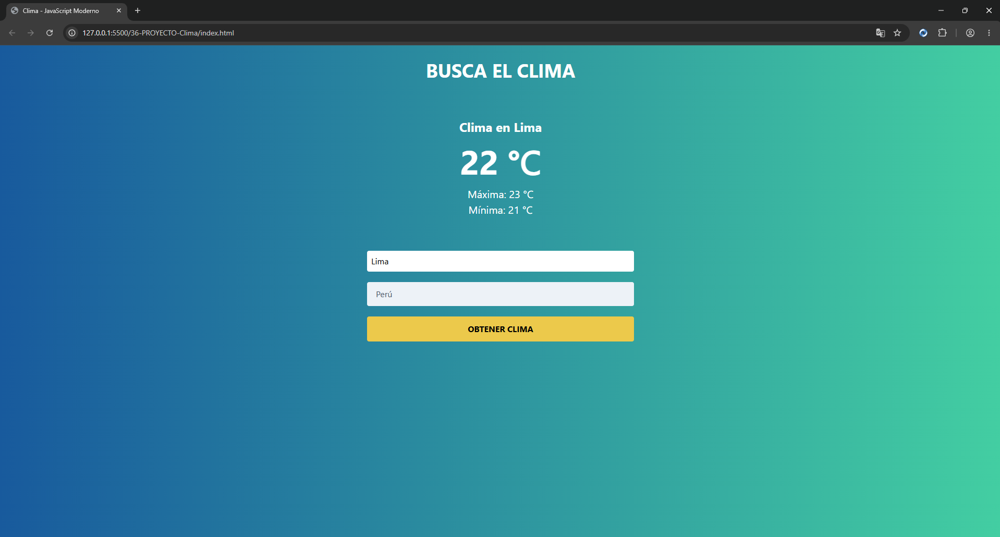

# 🌤️ Consulta del Clima

Aplicación web desarrollada con **HTML5, CSS3 y JavaScript** que permite consultar las condiciones meteorológicas de una ciudad mediante la API de OpenWeatherMap.

El usuario puede seleccionar un país e ingresar una ciudad para obtener información sobre la temperatura actual, máxima y mínima.

Este proyecto forma parte de mi aprendizaje de JavaScript y está enfocado en la práctica del consumo de APIs externas, programación asíncrona y manipulación dinámica del DOM.

## 🚀 Demo

🔗 [Ver aplicación en GitHub Pages](https://cristhianychr.github.io/consulta-clima-js/)

## 📸 Vista previa



> La consulta meteorológica requiere configurar una clave válida de OpenWeatherMap.

## ✨ Funcionalidades

- **Buscar por ciudad:** permite ingresar el nombre de una ciudad.
- **Seleccionar país:** ofrece una lista de países disponibles para realizar la búsqueda.
- **Consultar información meteorológica:** obtiene los datos mediante la API de OpenWeatherMap.
- **Mostrar temperatura actual:** presenta la temperatura de la ciudad consultada.
- **Mostrar temperaturas máxima y mínima:** permite conocer los valores extremos reportados por la API.
- **Conversión de temperatura:** transforma los valores de Kelvin a grados Celsius.
- **Validación de campos:** verifica que se haya ingresado una ciudad y seleccionado un país.
- **Mensajes de error:** informa cuando faltan datos o no se encuentra la ciudad.
- **Indicador de carga:** muestra un spinner mientras se realiza la consulta.
- **Actualización dinámica:** presenta los resultados directamente en la interfaz sin recargar la página.

## 🛠️ Tecnologías utilizadas

- **HTML5:** estructura de la aplicación y formulario de búsqueda.
- **CSS3:** estilos personalizados y animación del indicador de carga.
- **Tailwind CSS:** diseño de la interfaz mediante clases utilitarias.
- **JavaScript (ES6+):** lógica de la aplicación y manipulación del DOM.
- **Fetch API:** comunicación con servicios externos.
- **OpenWeatherMap API:** obtención de información meteorológica.
- **Git y GitHub:** control de versiones y publicación del proyecto.

## 🧠 Conceptos de JavaScript aplicados

- Manipulación del DOM con `querySelector`, `createElement` y `appendChild`.
- Gestión de eventos con `addEventListener`.
- Prevención del comportamiento predeterminado de formularios con `preventDefault()`.
- Validación de formularios.
- Consumo de APIs externas mediante `fetch()`.
- Programación asíncrona con promesas y encadenamiento de `.then()`.
- Desestructuración de objetos.
- Template literals.
- Funciones flecha.
- Manipulación de clases CSS con `classList`.
- Temporizadores con `setTimeout()`.
- Conversión de unidades de temperatura.
- Creación y eliminación dinámica de elementos HTML.

## 🌐 API utilizada

El proyecto utiliza **OpenWeatherMap**, un servicio que proporciona información meteorológica a través de una API REST.

La consulta se realiza mediante el endpoint:

`https://api.openweathermap.org/data/2.5/weather`

Se envían los siguientes parámetros:

- `q`: ciudad y código del país.
- `appid`: clave de autenticación de la API.

La respuesta proporciona información meteorológica que posteriormente se procesa para mostrar las temperaturas en grados Celsius.

## 📂 Estructura del proyecto

```text
consulta-clima-js/
├── css/
│   ├── styles.css
│   └── tailwind.min.css
├── img/
│   └─ preview.png
├── js/
│   └── app.js
├── index.html
├── .gitignore
└── README.md
```

## ⚙️ Instalación y ejecución

1. Clona el repositorio:

   ```bash
   git clone https://github.com/cristhianychr/consulta-clima-js.git
   ```

2. Accede a la carpeta:

   ```bash
   cd consulta-clima-js
   ```

3. Configura tu propia clave de OpenWeatherMap en `js/app.js`:

   ```javascript
   const appId = 'YOUR_API_KEY';
   ```

4. Abre `index.html` en tu navegador.

## 📌 Aprendizajes

Este proyecto me permitió practicar el consumo de servicios externos mediante Fetch API y comprender cómo procesar respuestas JSON para presentar información dinámica en una aplicación web.

También reforcé el manejo de promesas, la validación de formularios, la manipulación del DOM y la conversión de unidades de temperatura.

## 👨‍💻 Autor

Proyecto desarrollado como parte de mi formación práctica en JavaScript y desarrollo web.

**Cristhian Chanamé**  
Estudiante de Ingeniería de Software.